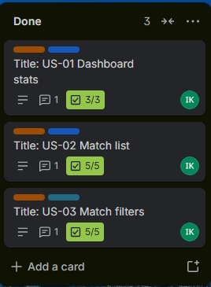
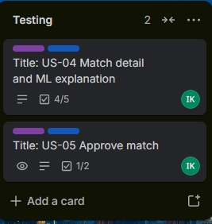

  

# Inam Klaas

## 📌Profile 
Motivated and tech-savvy third-year student pursuing a National Diploma in Application Development at the Cape Peninsula University of technology (CPUT). I am passionate about  software development and have hands on experience with programming languages such as Python, Java, HTML and CSS. I am eager to apply my academic knowledge and soft skills in a real world IT environment through internship or learning opotunities. Known for being adaptable, collaborative and a fast learner who thrives under pressure and is driven to achieve both personal and organizational goals.

------------------------------------

## 📞Contact 
📱Phone: 0634216647
📧Email: 222304502@mycput.ac.za
🌐Github: https://github.com/InamKlaas
💼LinkedIn: https://www.linkedin.com/in/inam-klaas

------------------------------------

## 🛠Skills
### Programming 
- Python
- Java
- HTML/CSS
- JavaScript

### Database 
- SQL (Basic)

### Tools
- Visual Studio
- Netbeans
- InteliJ IDEA
- Github

### Other 
- Microsoft office suite
- Computer literacy

------------------------------------

## 🎓Education 
### Cape Peninsula University of Technology (CPUT)
- National Diploma in Application Development
- 2024 - Present (Third year) 2026

### Siphamandla Senior Secondary School
- National Senior Certificate (Bachelor's Pass)
- 2017 - 2021

------------------------------------------------

## 💼Work Experience 

### Dischem Pharmacy - Merchandiser 
** 19 October 2023 - 16 January 2024 **
- Stock unpacking and shelf management
- Assisted customers and maintaned good service standard

### Rands Cape Town - cashier
** 25 April 2023 - 27 September 2023 **
- Customer service amd table management
- Assisted in bar maintanance and stock handling

### KFC Voorbaai - Cashier 
** 02 February 2023 - 17 April 2023 **
-Managed transactions and cleaned workstations
Delivered customer service in a fast paced environment 

---------------------------------------------------

## 🚀Projects 
- ** Matric Tutoring Service Application (2025)**
- ** Codveda Full-Stack Crud Application (2025)**
- ** Porfolio Website (2025)**

## 📌References 
- Mr Rafiek - Dischem store Manager
- 📞072 752 8618

- Mr Magadla - Rands Supervisor
- 📞062 434 7735

- ----------------------------------------------

## Download CV
[Download CV](./Inam-Klaas-CV.pdf) 

------------------------------------------------------

# Markdown CV Reflection

## 🧩Situation:
As part of the digital portfolio assessment, I was required to convert my traditional CV into a GitHub-friendly format using Markdown. This was a new experience for me, as I had previously only created CVs using word processors like Microsoft Word.

## 📋Task:
My task was to design and structure a professional CV using Markdown syntax while ensuring that it remains readable, well-organized, and visually appealing on GitHub.

## 💡Action:
I learned the basics of Markdown, including headings, lists, links, and formatting techniques. I structured my CV into clear sections such as Profile, Skills, Education, Work Experience, and Projects. I also enhanced the presentation by adding formatting elements like horizontal lines, emojis, and hyperlinks to my GitHub and LinkedIn profiles. Additionally, I used HTML within Markdown to improve layout, such as adding a profile image and aligning content.

## 📈Result:
As a result, I successfully created a clean and professional CV that is accessible online through GitHub. This process improved my technical documentation skills and understanding of Markdown, which is widely used in software development. It also enhanced my ability to present information clearly in a digital format.

-----------------------------------------------------------------------------------------------------------------------------------------

# Mork Interview 

Below is my mock interview demonstrating my communication and technical skills:

<iframe width="560" height="315" 
src="https://www.youtube.com/embed/bGXky5cxPvE" 
title="Mock Interview Video" 
frameborder="0" 
allowfullscreen>
</iframe>

# Mock Interview Reflection
## 🧩Situation:
During the work readiness training, I was required to participate in a mock interview and present myself professionally in a recorded video format.

## 📋Task:
My task was to prepare for and deliver a mock interview that demonstrates my communication skills, confidence, and understanding of common interview questions in the IT field.

## 💡Action:
I prepared by researching common interview questions and practicing my responses. I focused on clearly explaining my skills, academic background, and career goals. During the recording, I ensured that I maintained good posture, spoke clearly, and presented myself professionally. I also reviewed the video afterward to evaluate my performance and identify areas for improvement.

## 📈Result:
The mock interview helped me build confidence in answering interview questions and improved my communication skills. I became more aware of my body language, tone, and clarity when speaking. This experience has better prepared me for real-world interviews and professional interactions.

--------------------------------------------------------------------------------------------------------------------------------------

# Github Pages Reflection

## 🧩Situation:
As part of the assessment, I was required to publish my digital portfolio online using GitHub Pages, which was a new platform for me.

## 📋Task:
My task was to deploy my GitHub repository as a live website and ensure that all elements of my portfolio, including my CV and mock interview, were accessible and properly displayed.

## 💡Action:
I learned how to enable GitHub Pages through the repository settings and selected the appropriate branch for deployment. I ensured that my README file was properly formatted and that all links, images, and files were correctly referenced. I also tested the live site to confirm that everything was functioning as expected.

## 📈Result:
I successfully published my portfolio as a live website, making it easily accessible to others. This experience improved my understanding of web deployment and version control. It also gave me practical skills in presenting my work professionally online, which is essential for a career in IT.

-----------------------------------------------------------------------------------------------------------------------------------------

# SEMESTER 2 

---

## 🧭 Agile Project Portfolio: YES-App

**Student:** Inam Klaas  
**Project:** YES-App, a platform that connects unemployed youth with NPOs that place youth into jobs, using ML matches and scores.  
**My role:** Host side of the app (host dashboard), with shared work on the database.  
**Team:** Tlou (youth side), Shaun (manager).  
**Project dates:** 25 September 2026 to 22 October 2026

**Jump to a section:**
[Team Charter](#agile-charter) · [User Stories and Tasks](#agile-stories) · [Product Backlog](#agile-backlog) · [Sprint Backlog](#agile-sprints) · [Agile Logbook](#agile-logbook)

### Overall reflection

Working on the YES-App showed me how the Agile sections depend on each other: the verbal charter set how we worked, Shaun's direction became the user stories and backlog, and the sprints and logbook recorded how far we got. Compared with my one-week builds from July to September (the ResConnect app, the ResConnect chatbot and the sentiment insights app), this project ran in two sprints with checkpoint meetings, which made progress and gaps easier to see.

Building the Trello board after the work had started also taught me something. Because our agreements were never written down, I only saw clearly what was finished and what was outstanding once I put it on the board. Next time I would write the charter down in the first week and keep the board up to date from day one.

---

## 🤝 Agile Team Charter

### Evidence

The charter was discussed with the team from 25 September to 6 October 2026. It was agreed verbally and never written down. The version below is written up for this portfolio from what the team agreed.

**Purpose**  
The YES-App connects unemployed youth with NPOs that want to place youth into jobs, based on ML matches and scores. Our team builds a youth dashboard and a host dashboard, with a shared database behind them, so that placements are based on clear and fair matches.

**Values**
1. **Understand before building:** we asked questions until we all understood what was needed.
2. **Stay aligned:** we checked in with our manager regularly, and he explained again whenever we needed it.
3. **Shared decisions:** we shared ideas openly and went ahead once we all approved.

**Working agreements**
- **Meetings:** calls on Google Meet. Shaun, our manager, called us to explain what to add and change. Checkpoint meetings were on 13 October and 22 October.
- **Communication:** a WhatsApp group for day-to-day messages.
- **Collaboration:** GitHub for code. My host dashboard work is on the branch `host-workflows`.
- **Scope:** the youth dashboard, the host dashboard, the features for each, and the database.
- **Decisions:** we asked questions, shared ideas, and went ahead once everyone approved.
- **Definition of done:** a feature is done when it is pushed to GitHub and Shaun has given feedback.

**Boundaries**
- Do not delete or break the existing youth and host screens.
- Do not hardcode one organization; the host role is generic (`host_org_worker`).
- Never overwrite the original ML score; a human override only changes the final score.

**Roles**

| Person | Role |
|---|---|
| Shaun | Manager: explains what to add and change, and gives feedback on pushed work |
| Inam | Host side of the app; shared work on the database |
| Tlou | Youth side of the app; shared work on the database |

### Reflection

**What:** The charter came out of a week of discussion, from 25 September to 6 October, about the app's future, our goals and how we would reach them, and I chose it as evidence because it shows how our team agreed to work. It was never written down, so the version on this page is my write-up of what we agreed.

**So what:** Because the agreements were only verbal, we kept checking in with Shaun and he explained again whenever we were unsure, which kept us aligned on the youth and host dashboards. The cost was that we had no shared record of the work we had done and the work still to do.

**Now what:** Next time I would write the charter down in the first week and keep it where the whole team can see it, such as on the Trello board. That would make it easier to track what is finished and what is outstanding.

**Connect:** The check-ins with Shaun described in the charter appear again as the 13 and 22 October meetings in my logbook. The scope we agreed became the user stories and backlog, and recording them on Trello gave me the written tracking the charter lacked.

[Back to top](#agile-portfolio)

---

## 📝 User Stories and Tasks

### Evidence

I wrote 11 user stories for the host dashboard and broke each into tasks, which I recorded on Trello. Each card has an epic label and a priority label (Must or Should), a member, and a checklist of tasks. The screen layout was provided by Shaun, and I did the implementation.

| ID | User story | Tasks | Labels | Status (28 Oct) |
|---|---|---|---|---|
| US-01 | As a host organization worker, I want to see total youth, companies, pending verifications and contested matches so that I know what needs my attention first. | Build `GET /api/admin/stats`; add stat cards to HostDashboard; link stat cards to filters | Epic: Host Dashboard, Must | Done |
| US-02 | As a host organization worker, I want to see recent ML matches with score, reason and status so that I can review who is being matched to which SME. | Build `GET /api/matches`; build match list rows; add score badge and status pill | Epic: Host Dashboard, Must | Done |
| US-03 | As a host organization worker, I want to filter matches by score and status so that I can focus on low-confidence or pending matches. | Add status and min_score params; add filter chips; sort pending and contested first | Epic: Host Dashboard, Should | Done |
| US-04 | As a host organization worker, I want to open a match and see the youth profile, company requirements and the ML explanation so that I can judge whether the score is fair. | Build `GET /api/matches/{id}`; build MatchDetailScreen; show matched and missing skills | Epic: ML Oversight, Must | Testing |
| US-05 | As a host organization worker, I want to approve a match so that the youth can be deployed to the SME. | Build `POST /api/matches/{id}/approve`; add Approve button with confirmation | Epic: ML Oversight, Must | Testing |
| US-06 | As a host organization worker, I want to contest or override an ML score with a comment so that my knowledge of the youth corrects the model. | Build contest endpoint; validate comment and 0-100 score; build ContestModal; show "ML 80% -> Human 90%" badge | Epic: ML Oversight, Must | In progress |
| US-07 | As an auditor, I want the original ML score kept alongside the human override so that every correction is traceable. | Add score, reason and contester fields; test that the original score never changes | Epic: Server, Must | In progress |
| US-08 | As a host organization worker, I want to verify or reject youth with notes so that only vetted youth are deployed. | Pending and verify endpoints; VerifyYouthScreen; require notes on reject | Epic: Verification, Must | Not started |
| US-09 | As a host organization worker, I want to verify or reject SMEs by checking their details so that youth are only placed with legitimate companies. | Pending and verify endpoints; VerifyCompanyScreen | Epic: Verification, Should | Not started |
| US-10 | As a developer, I want the app to call the real server instead of mock data so that the dashboard shows live information. | Add base URL to `.env`; build `api.ts`; update store and types; add mock fallback flag | Epic: App, Must | Not started |
| US-11 | As a platform owner, I want a generic `host_org_worker` role guarded on the server so that any host organization can use it and others cannot access admin data. | Add role to types and navigation; add server role check; return 403 for other roles | Epic: App, Should | Not started |

### Reflection

**What:** I chose these 11 stories and the expanded US-08 card because they show how I broke the host dashboard into small pieces of work, each with an epic label, a priority and a checklist of tasks. Shaun gave us the screen layout and I did the implementation.

**So what:** Writing each story in the "As a... I want... so that..." form made me think about why a feature matters to a host organization worker, not only what to build. Splitting stories into tasks, such as an endpoint, a screen and a validation step, made progress visible through the checklist count on each card.

**Now what:** Next time I would keep each story small enough to finish inside one sprint. I would also check each card's checklist before the sprint starts so the task counts are accurate.

**Connect:** The stories came from the features Shaun directed us to add during the charter discussions. They became the product backlog, and the Must and Should labels helped decide which stories went into each sprint.

[Back to top](#agile-portfolio)

---

## 📋 Product Backlog

### Evidence

The product backlog is a prioritised list of everything planned for the host dashboard. Statuses are as at 28 October 2026, taken from the Trello board.

**Still in the Product Backlog list (not yet started):**

**Stories that have moved out of the backlog:**

| Rank | ID | Item | Type | Priority | Status |
|---|---|---|---|---|---|
| 1 | US-01 | Dashboard stats | Feature | Must | Done |
| 2 | US-02 | Match list | Feature | Must | Done |
| 3 | US-03 | Match filters | Improvement | Should | Done |
| 4 | US-04 | Match detail and ML explanation | Feature | Must | Testing |
| 5 | US-05 | Approve match | Feature | Must | Testing |
| 6 | US-06 | Contest / override ML score | Feature | Must | In progress |
| 7 | US-07 | Preserve original ML score | Feature | Must | In progress |
| 8 | US-10 | Link app to server API | Feature | Must | Not started |
| 9 | US-08 | Verify youth | Feature | Must | Not started |
| 10 | US-09 | Verify companies | Feature | Should | Not started |
| 11 | US-11 | Host role and server guard | Improvement | Should | Not started |

### Reflection

**What:** The product backlog is my ranked list of all 11 stories, and the Trello screenshots show it split between work still waiting, work in testing and work done. I chose them because they show both my priorities and how far the work has got.

**So what:** I ranked the dashboard and match screens first because Shaun gave us the layout, and I built the actions on a match and the verification work after that. Items 8 to 11 (the API link, verification and the role guard) are not started because the earlier Must stories were still being completed.

**Now what:** Next time I would rank by dependency and effort together, and ask Shaun to confirm the order at the start of each sprint. I would also take fewer Must stories into a sprint so the top-ranked ones are fully finished.

**Connect:** The backlog order decided which stories went into Sprint 1 and Sprint 2. The statuses on the board link back to the logbook, where the 13 and 22 October meetings recorded what was done.

[Back to top](#agile-portfolio)

---

## 🏃 Sprint Backlog

### Evidence

I planned the work in two sprints, one for each period between the team's checkpoint meetings. Each sprint has a goal and a card on the Trello Sprint Backlog list.

### Sprint 1: 25 September to 13 October 2026

**Sprint goal:** A host organization worker can see an overview of the platform and review ML matches with their scores, reasons and status.

| Story | Task | Owner | Estimate | Outcome (28 Oct) |
|---|---|---|---|---|
| US-01 | Stats endpoint; stat cards; link cards to filters | Inam | Not estimated | Done |
| US-02 | Matches endpoint; match list rows; score badge and status pill | Inam | Not estimated | Done |
| US-03 | Status and score filters; filter chips; sort order | Inam | Not estimated | Done |
| US-04 | Match detail endpoint; MatchDetailScreen; matched and missing skills | Inam | Not estimated | Testing (4 of 5 tasks ticked) |

**Outcome:** Sprint 1 covered US-01 to US-04. US-01 to US-03 are done, and US-04 is in testing with 4 of 5 tasks ticked.

### Sprint 2: 13 October to 22 October 2026

**Sprint goal:** A host organization worker can act on an ML match by approving it or contesting it with a comment and a new score.

| Story | Task | Owner | Estimate | Outcome (28 Oct) |
|---|---|---|---|---|
| US-05 | Approve endpoint; Approve button with confirmation | Inam | Not estimated | Testing (1 of 2 tasks ticked) |
| US-06 | Contest endpoint; validation; ContestModal; score diff badge | Inam | Not estimated | In progress (3 of 4 tasks ticked) |
| US-07 | Store original and final score, contester and reason; check original score is unchanged | Inam | Not estimated | In progress (1 of 2 tasks ticked) |

**Outcome:** Sprint 2 covered US-05 to US-07. US-05 is in testing, and US-06 and US-07 are in progress, so they carry over into the backlog.

### Reflection

**What:** The sprint backlog shows the work I selected for each sprint and the goal it served: reviewing ML matches in Sprint 1 and acting on them in Sprint 2. I chose these screenshots because the board shows the real state of each card.

**So what:** Sprint 1 went to plan for the first three stories, but US-04 was still in testing at the end, and Sprint 2 finished with US-05 in testing and US-06 and US-07 in progress. The charter discussions ran from 25 September to 6 October, which left about a week of Sprint 1 for building, so I took on more than I could fully finish and test.

**Now what:** Next time I would estimate each task and take on less per sprint so the sprint goal is met in full. I would also move a card to Done only when every checklist item is ticked, so the board always matches the outcome.

**Connect:** Each sprint goal came from the top of the product backlog, and the results were reviewed with Shaun at the 13 and 22 October meetings. The unfinished stories carry forward into the backlog.

[Back to top](#agile-portfolio)

---

## 📓 Agile Logbook

### Evidence

The logbook is the Agile Logbook list on my Trello board, with one card for each session.

**25 September 2026: Project kick-off and sprint planning**
- **Type:** Sprint planning
- **Attendees:** Shaun, Tlou, Inam
- **What happened:** Shaun called us to explain what to add and change in the app. Charter discussions started.
- **Sprint 1 goal:** A host organization worker can see an overview of the platform and review ML matches.
- **Decisions / actions:** We agreed to build a youth dashboard, a host dashboard, their features and a shared database. We chose Google Meet for calls, WhatsApp for messages and GitHub for code.

**6 October 2026: Charter agreed**
- **Type:** Team agreement
- **What happened:** A week of discussion about the app's future, goals, and how to reach them.
- **Decisions / actions:** The scope was agreed verbally. Tlou took the youth side, I took the host side, and we shared the database. Nothing was written down.

**13 October 2026: Sprint 1 review, retrospective and Sprint 2 planning**
- **Attendees:** Shaun, Tlou, Inam
- **Done since 25 Sep:** US-01, US-02 and US-03; US-04 in testing
- **Doing next:** US-05, US-06 and US-07
- **Blockers:** None recorded
- **What went well:** The first three stories were finished, and checking in with Shaun kept us aligned. His layout gave me a clear starting point for the host dashboard.
- **What went badly:** US-04 was not fully tested. Because nothing was written down, it was hard to see exactly what was done and what was left.
- **What we will change:** Move on to the actions on a match (approve and contest), and track each task as it is finished.

**22 October 2026: Sprint 2 review and retrospective**
- **Attendees:** Shaun, Tlou, Inam
- **Status:** US-05 in testing; US-06 and US-07 in progress
- **Not started:** US-08, US-09, US-10, US-11
- **Blockers:** None recorded
- **What went well:** The contest feature saves to the database, and Shaun's feedback kept the host dashboard in line with what he wanted.
- **What went badly:** Several stories were left unfinished, and the verification screens, the API link and the role guard are not started.
- **What we will change:** Take on fewer stories per sprint, finish and test each one before starting the next, and write short notes after every call.

**Background: July to September 2026**

| Dates | Work |
|---|---|
| July, week 1 | ResConnect app |
| July, week 2 | ResConnect chatbot |
| July, week 3 until the last week | Sentiment insights app |
| September to 25 Sep | Onboarding |

### Reflection

**What:** The logbook records the key sessions of the project, from the 25 September kick-off to the 22 October checkpoint, and I chose it because it shows how we planned and reviewed our work with Shaun. The July to September builds are included as background for the habits I brought to this project.

**So what:** The 13 and 22 October meetings with Shaun worked as our sprint reviews, where we checked what was done and what he wanted added or changed. After the 13 October review I moved from viewing matches to acting on them with approve and contest, and I kept asking Shaun whenever I was unsure, as our charter said.

**Now what:** Next time I would write short notes straight after every call so the details of what was decided are not lost. I would also record daily progress between meetings, not only the checkpoints.

**Connect:** The charter's values of asking questions and staying aligned appear in every entry as check-ins with Shaun. The outcome of each review shaped the next sprint's backlog, which is how the five sections work together.

[Back to top](#agile-portfolio)

---

